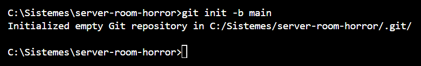
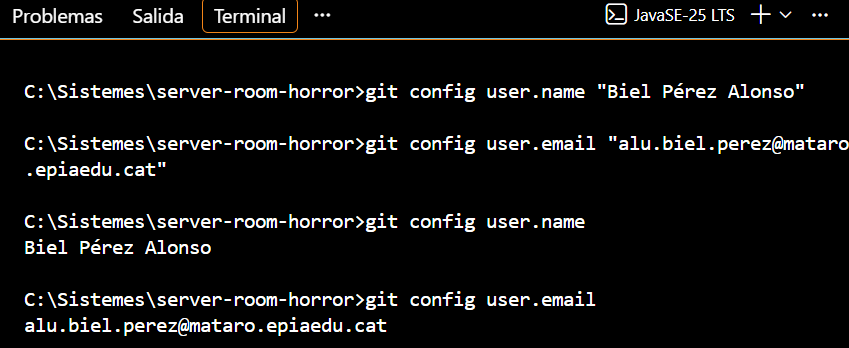
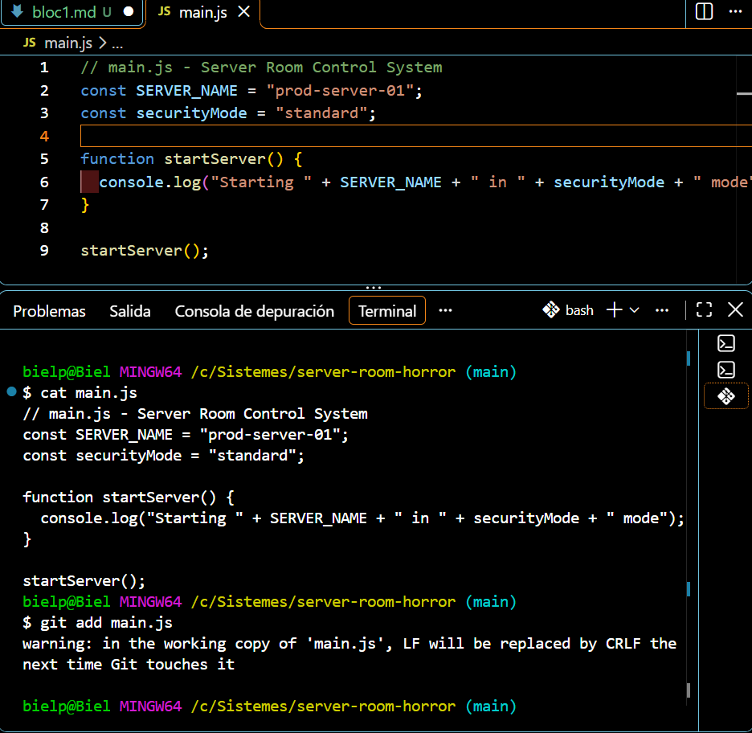
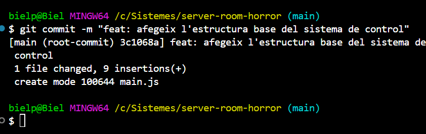
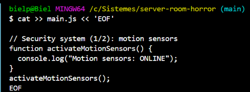
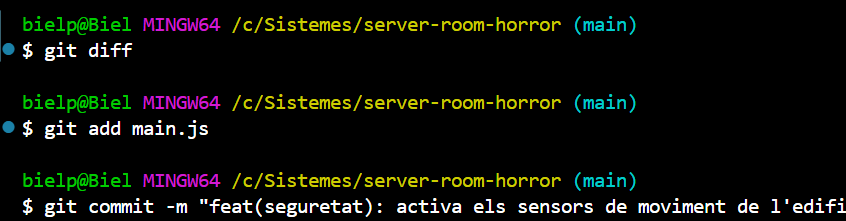
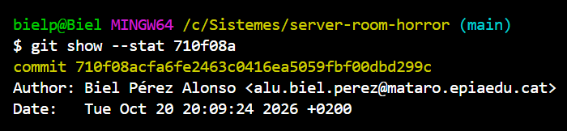
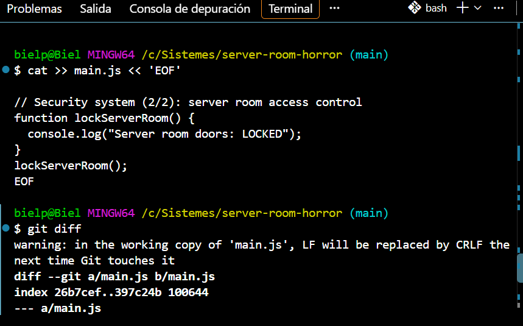
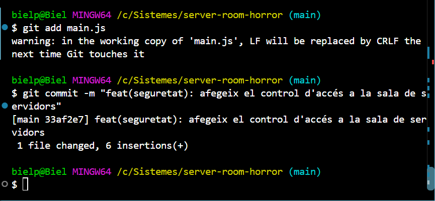
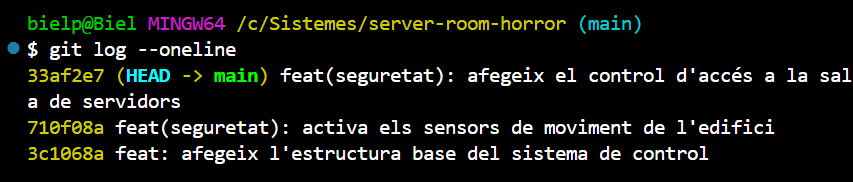

# Bloc 1: Invocació del Repositori i Línia Base

## Acció 3.1 — Creació del directori i inicialització del repositori

**Explicació tècnica.** Dins del directori buit `server-room-horror` s'inicialitza un repositori Git amb `git init`. L'opció `-b main` fa que la branca principal s'anomeni `main`. Git crea la carpeta oculta `.git`, on es desa tot l'historial, les branques i la configuració.

```bash
git init -b main
```



## Acció 3.2 — Configuració de la identitat del control de versions

**Explicació tècnica.** Cada commit registra el nom i el correu de l'autor. Com que s'executa `git config` sense `--global`, la identitat només s'aplica a aquest repositori (es desa a `.git/config`). Les dues últimes ordres comproven els valors desats.

```bash
git config user.name "Biel Pérez Alonso"
git config user.email "alu.biel.perez@mataro.epiaedu.cat"
git config user.name
git config user.email
```



## Acció 3.3 — Creació del fitxer principal i primer commit

**Explicació tècnica.** Es crea `main.js` amb l'estructura base del sistema: la constant `SERVER_NAME`, la variable `securityMode` i la funció `startServer()`. `git add` afegeix el fitxer a l'àrea de preparació (*staging*) i `git commit` crea el primer commit de l'historial.

```bash
cat main.js
git add main.js
git commit -m "feat: afegeix l'estructura base del sistema de control"
```





## Acció 3.4 — Instal·lació del sistema de seguretat (2n i 3r commit)

**Explicació tècnica.** S'apliquen dues modificacions successives a `main.js`, cadascuna en un commit separat per mantenir la traçabilitat. Abans de cada commit, `git diff` mostra les línies afegides (marcades amb `+`).

```bash
cat >> main.js << 'EOF'

// Security system (1/2): motion sensors
function activateMotionSensors() {
  console.log("Motion sensors: ONLINE");
}
activateMotionSensors();
EOF
git diff
git add main.js
git commit --amend -m "feat(seguretat): activa els sensors de moviment de l'edifici"
git show --stat 710f08a
```







### Segona modificació: control d'accés a la sala (3r commit)

```bash
cat >> main.js << 'EOF'

// Security system (2/2): server room access control
function lockServerRoom() {
  console.log("Server room doors: LOCKED");
}
lockServerRoom();
EOF
git diff
git add main.js
git commit -m "feat(seguretat): afegeix el control d'accés a la sala de servidors"
```





## Acció 3.5 — Verificació de la línia temporal inicial

**Explicació tècnica.** `git log --oneline` mostra l'historial simplificat: una línia per commit, amb el hash abreujat i el missatge. Es veuen els 3 commits en ordre, així que la línia temporal inicial és estable.

```bash
git log --oneline
```



[Tornar al README](README.md)