# Bloc 2: Les Branques del Més Enllà i Resolució del Conflicte

## Acció 3.6 — Creació de les branques `feature-nightmare` i `feature-sanctuary`

`<nom>` no es un comando. En catalán **"nom" significa "nombre"**, y en la explicación se usa como marcador: indica que ahí va el nombre de la rama que quieras crear. Los `< >` solo señalan que hay que sustituirlo.

En tu caso, `<nom>` se convierte en:

```bash
git branch feature-nightmare
```
```bash
git branch feature-sanctuary
```

Si prefieres que en `bloc2.md` quede más claro, puedes cambiar esa frase por esta:

> **Explicació tècnica.** `git branch <nom_de_la_branca>` crea una branca nova amb el nom indicat, que apunta al commit actual, sense canviar-s'hi. S'han creat les dues branques (`feature-nightmare` i `feature-sanctuary`) des de `main`, a partir del mateix commit estable (`33af2e7`). `git branch -v` mostra que les tres branques apunten al mateix commit.

```bash
git branch feature-nightmare
git branch feature-sanctuary
git branch -v
```

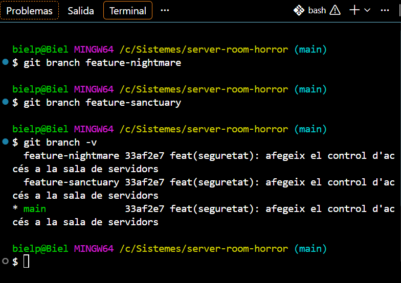


## Acció 3.7 — La visió fosca (`feature-nightmare`)

**Explicació tècnica.** `git switch` canvia a la branca `feature-nightmare`. Amb `sed -i` es modifica la línia `const securityMode = "standard";` perquè el sistema passi al mode `"nightmare"`. `git diff` mostra el canvi abans de desar-lo, i el commit el registra només en aquesta branca.

```bash
git switch feature-nightmare
sed -i 's/const securityMode = "standard";/const securityMode = "nightmare";/' main.js
git diff
git add main.js
git commit -m "feat(nightmare): injecta el mode de seguretat de la visió fosca"
```

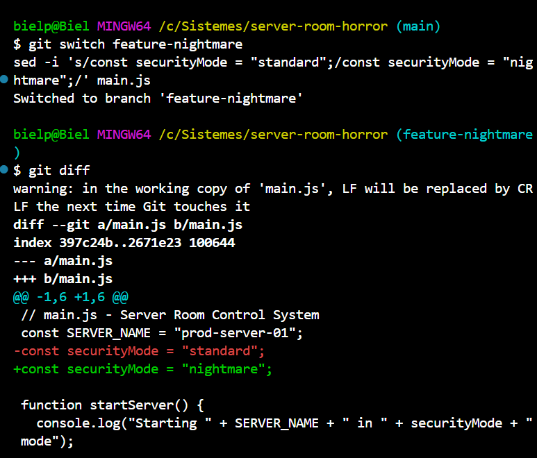

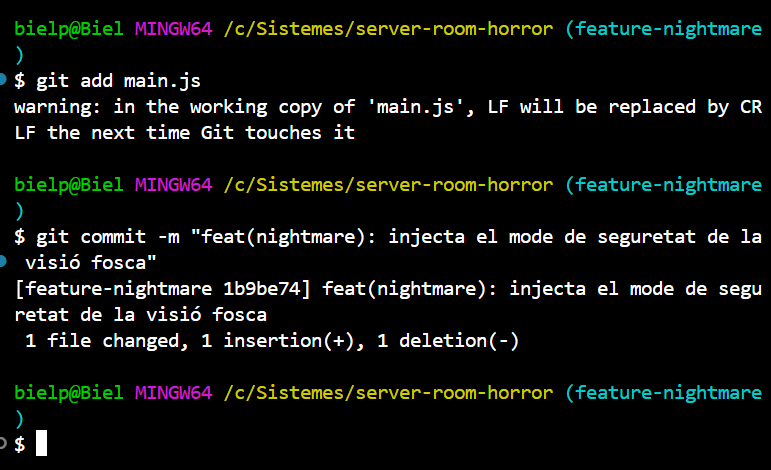


## Acció 3.8 — La línia temporal de protecció (`feature-sanctuary`)


**Explicació tècnica.** En canviar a `feature-sanctuary`, `main.js` torna a tenir el valor `"standard"`: el canvi de la visió fosca només existeix a la seva branca, cosa que demostra l'aïllament. Es modifica **exactament la mateixa línia**, ara amb el valor `"sanctuary"`, i es desa en un commit.

```bash
git switch feature-sanctuary
sed -i 's/const securityMode = "standard";/const securityMode = "sanctuary";/' main.js
git diff
git add main.js
git commit -m "feat(sanctuary): estableix el mode de protecció del santuari"
```

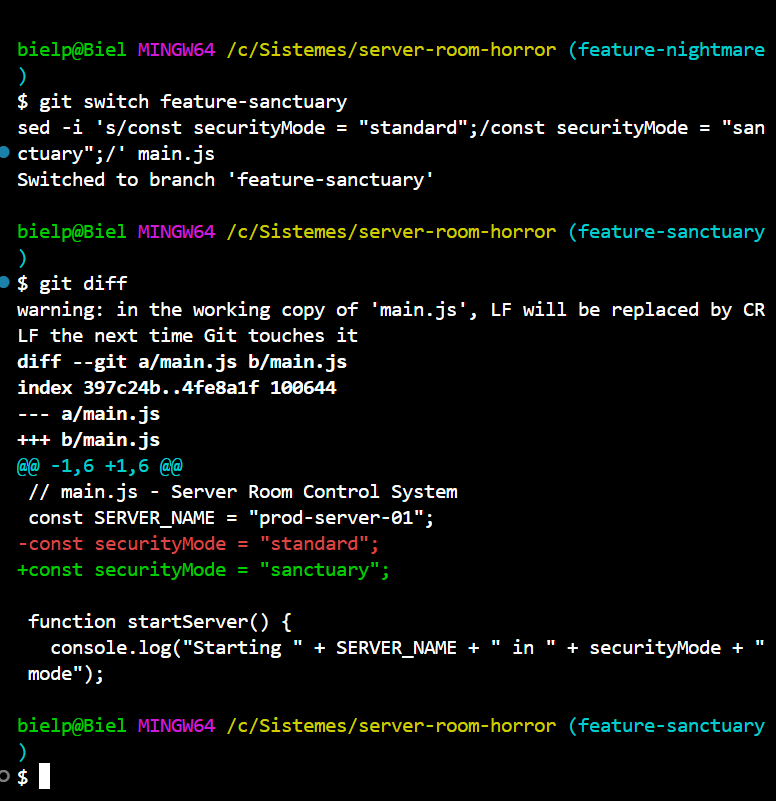

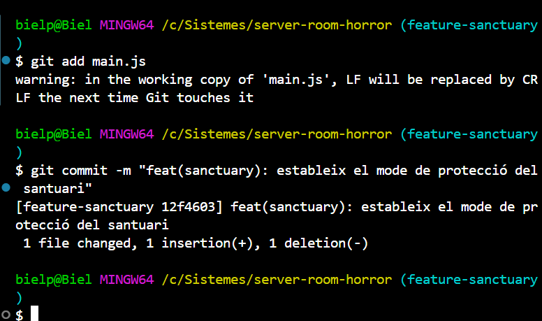


## Acció 3.9 — El ritual de fusió

**Explicació tècnica.** Es torna a `main` i s'integra primer `feature-nightmare`. S'ha fet servir `--no-ff` perquè, sense aquesta opció, Git faria un *fast-forward* (només mouria el punter) i no quedaria cap commit d'integració a l'historial. Amb `--no-ff` es crea un commit de fusió i la topologia de branques es veu al graf. Després s'intenta integrar `feature-sanctuary`. Com que les dues branques han modificat la mateixa línia, Git no pot decidir quina versió és la bona i atura la fusió amb un **conflicte**.

```bash
git switch main
git merge --no-ff feature-nightmare -m "merge: integra la branca feature-nightmare"
git merge feature-sanctuary
```

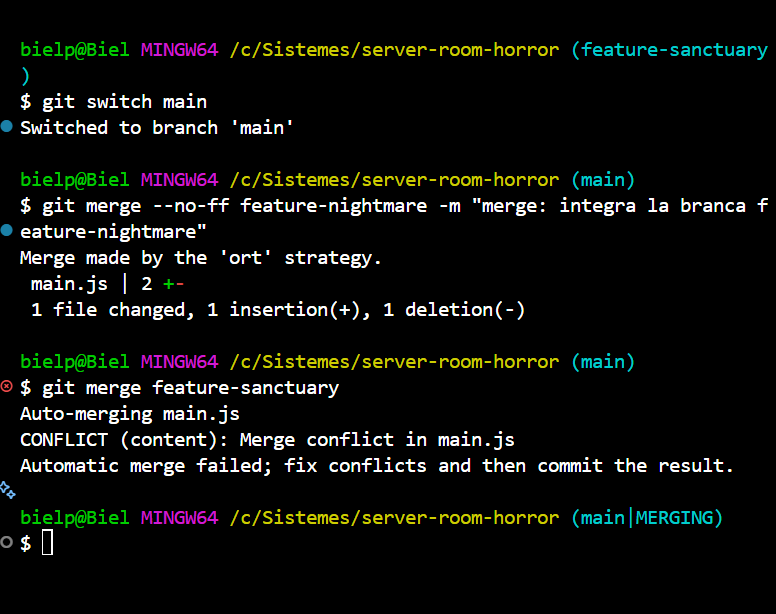


## Acció 3.10 — Resolució del conflicte i commit de fusió

**Explicació tècnica.** `git status` indica que `main.js` està en estat *both modified*. Dins del fitxer, Git ha marcat la zona en conflicte:

- `<<<<<<< HEAD`: inici de la versió de la branca actual (`main`, amb `"nightmare"`).
- `=======`: separador entre les dues versions.
- `>>>>>>> feature-sanctuary`: final de la versió de la branca que s'integra.


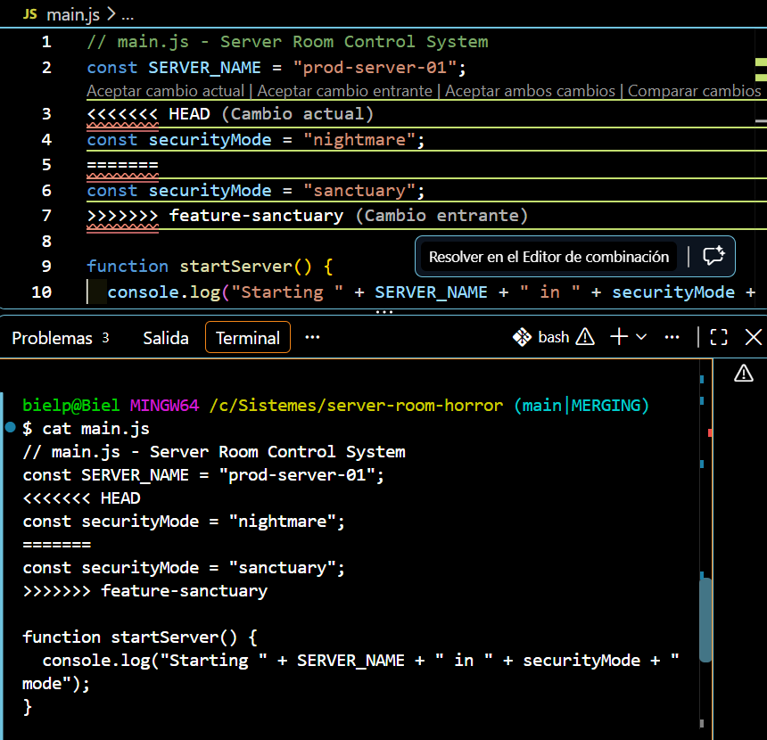

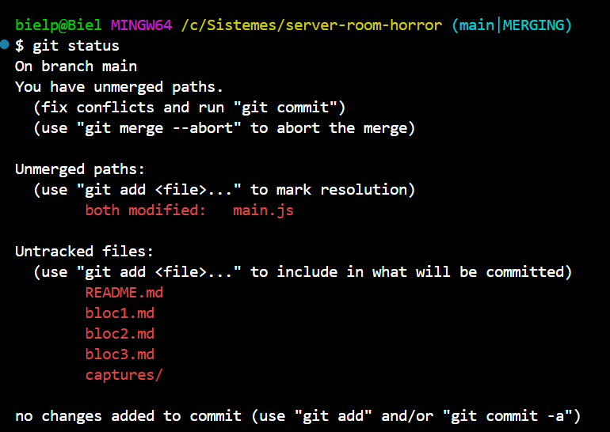

S'ha editat `main.js` manualment: s'han eliminat les tres marques i la línia de la visió fosca, i s'ha conservat `const securityMode = "sanctuary";`, perquè el mode de protecció és el que salva el servidor. Amb `grep` es comprova que no queda cap marca (no mostra res). Finalment, `git add` marca el conflicte com a resolt i `git commit` crea el commit de fusió.

```bash
git status
cat main.js
grep -nE '^(<<<<<<<|=======|>>>>>>>)' main.js
git add main.js
git commit -m "merge: resol el conflicte entre feature-nightmare i feature-sanctuary"
git log --oneline --graph --all
```

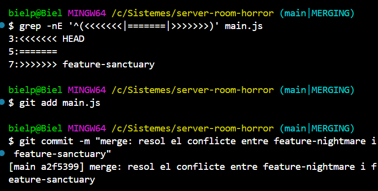

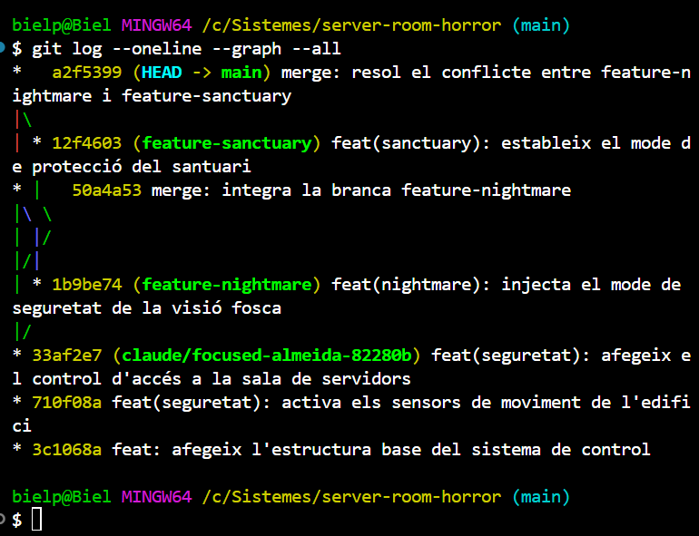

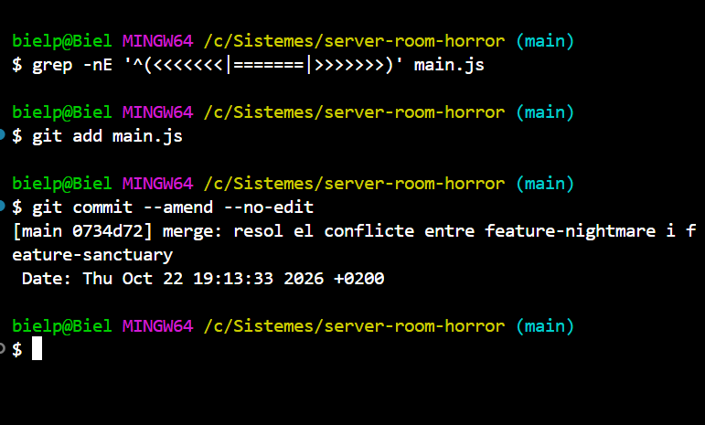


[Tornar al README](README.md)
