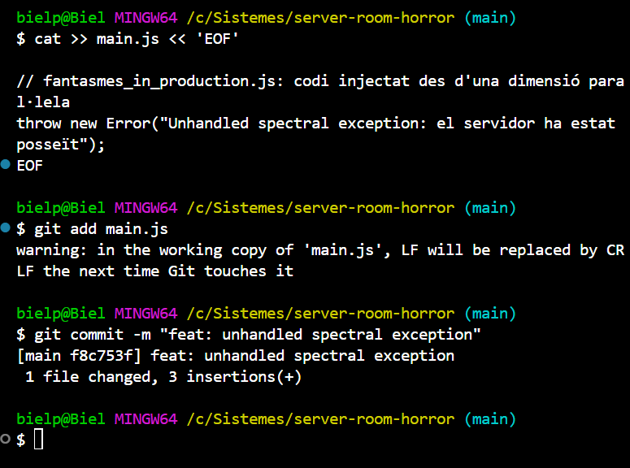
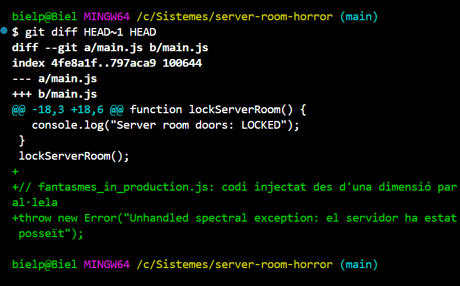
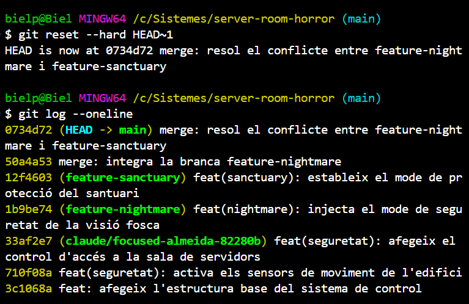
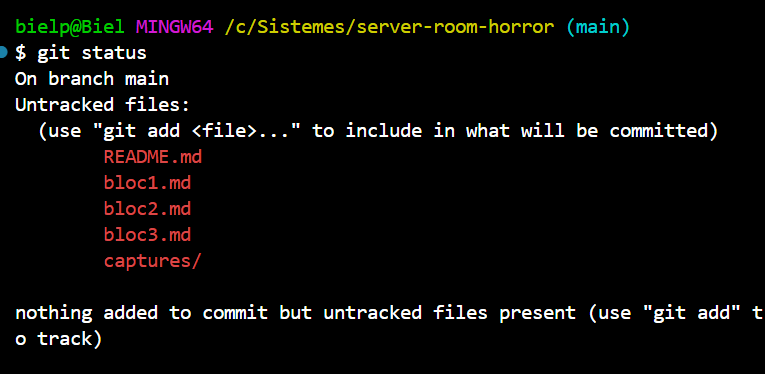
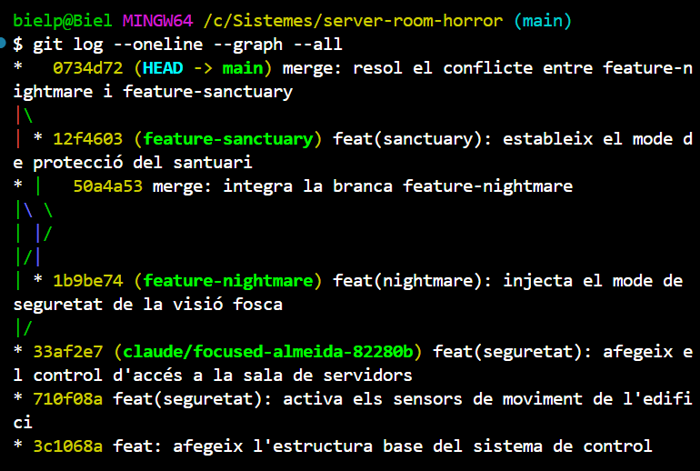
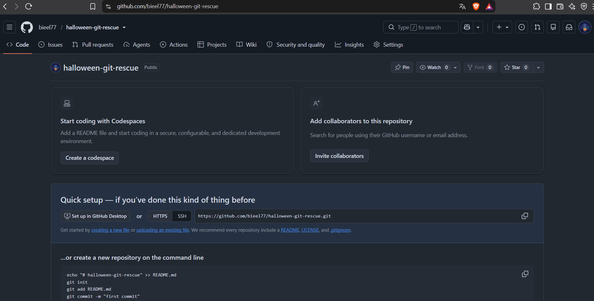
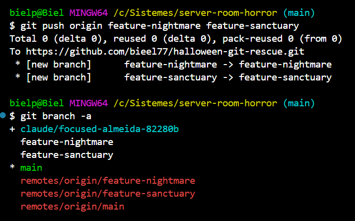

# Bloc 3: Viatge Temporal, Exorcisme del Codi i Publicació Remota

## Acció 3.11 — El commit infectat

**Explicació tècnica.** L'esperit maligne injecta a `main.js` una excepció que no es gestiona en cap lloc (`throw new Error(...)`). En executar-se, aturaria el servidor. El canvi s'afegeix al final del fitxer i es registra a l'historial amb el missatge `feat: unhandled spectral exception`. A partir d'aquest moment, la línia temporal queda corrompuda.

```bash
cat >> main.js << 'EOF'

// fantasmes_in_production.js: codi injectat des d'una dimensió paral·lela
throw new Error("Unhandled spectral exception: el servidor ha estat posseït");
EOF
git add main.js
git commit -m "feat: unhandled spectral exception"
```




## Acció 3.12 — Anàlisi forense: diferència amb l'últim punt segur

**Explicació tècnica.** `git diff HEAD~1 HEAD` compara el commit actual (`HEAD`, l'infectat) amb el commit anterior (`HEAD~1`, el commit de fusió, que és l'últim punt segur). Les línies que comencen amb `+` són el codi que ha injectat l'esperit. Així es pot veure exactament què s'ha de netejar.

```bash
git diff HEAD~1 HEAD
```




## Acció 3.13 — Exorcisme: reversió temporal

**Explicació tècnica.** `git reset --hard HEAD~1` mou la branca `main` un commit enrere, fins al commit de fusió segur:
- **Historial:** el commit infectat desapareix de `git log`.
- **Àrea de preparació i espai de treball:** amb `--hard`, `main.js` es restaura exactament a l'estat del commit segur, i el codi infectat s'elimina també del fitxer.

S'ha triat `reset --hard` i no `git revert` perquè l'enunciat demana esborrar el registre de l'historial. `revert` crearia un commit nou i el commit infectat continuaria visible. Després es comprova amb `git log` i `git status` que la línia temporal està neta.

```bash
git reset --hard HEAD~1
git log --oneline
git status
```





## Acció 3.14 — Topologia final del repositori

**Explicació tècnica.** `git log --oneline --graph --all` dibuixa a la terminal l'arbre de tot el repositori:
- `--graph` mostra les línies de les branques i les fusions.
- `--all` inclou totes les branques, no només l'actual.

Es veu la línia base (3 commits), la bifurcació cap a `feature-nightmare` i `feature-sanctuary`, els dos commits de fusió a `main`, i que el commit infectat ja no existeix.

```bash
git log --oneline --graph --all
```




## Acció 3.15 — Publicació a GitHub (`halloween-git-rescue`)

**Explicació tècnica.** Primer s'ha creat a GitHub un repositori **públic** buit anomenat `halloween-git-rescue`, sense README ni `.gitignore` per evitar conflictes amb l'historial local.

Després:
1. S'afegeix la documentació (`README.md`, els tres `blocN.md` i la carpeta `captures/`) amb un commit `docs`.
2. `git remote add` vincula el repositori local amb el remot amb el nom `origin`.
3. `git push -u origin main` puja `main` i en configura el seguiment.
4. Es pugen també les dues branques de treball, perquè l'auditoria pugui veure tot l'historial.



```bash
git add README.md bloc1.md bloc2.md bloc3.md captures/
git commit -m "docs: afegeix la documentació de la pràctica"
git remote add origin https://github.com/EL_TEU_USUARI/halloween-git-rescue.git
git remote -v
git push -u origin main
git push origin feature-nightmare feature-sanctuary
git branch -a
```



[Tornar al README](README.md)